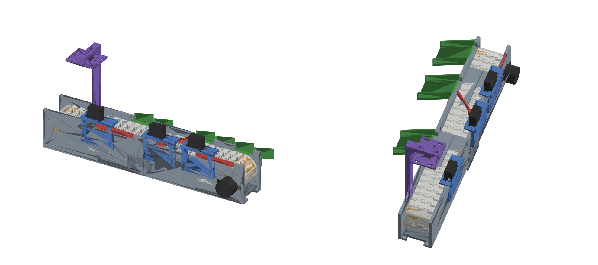

A Statistical Classification of Dry Beans for Quality Monitoring in Packaging
==========================================

This project explores advanced statistical and machine learning methods applied to the Dry Bean dataset, with the goal of classifying beans into their respective categories to support quality control in packaging. The analysis demonstrates how features extracted from bean images can be used to assess and sort beans, helping ensure consistent product quality.


Project Overview
----------------

This project was developed as part of my individual coursework. The dataset contains 13,611 bean samples across 7 registered varieties (Seker, Barbunya, Bombay, Cali, Dermosan, Horoz, Sira), with 16 features per sample, including area, perimeter, axis lengths, shape factors, and other geometric properties. These features form the basis for classification and dimensionality reduction using methods such as Principal Component Analysis (PCA) and Random Forest Classifiers.

### Key Features of the Dataset:

1.  **Area (A)**: Area of a bean zone, representing the number of pixels within its boundaries.
2.  **Perimeter (P)**: Length of the bean's border (circumference).
3.  **Major Axis Length (L)**: The longest distance between two points on the bean.
4.  **Minor Axis Length (l)**: The longest distance perpendicular to the major axis.
5.  **Aspect Ratio (K)**: The ratio between the major and minor axes.
6.  **Eccentricity (Ec)**: Eccentricity of an ellipse with the same moments as the bean.
7.  **Convex Area (C)**: Area of the smallest convex polygon surrounding the bean.
8.  **Equivalent Diameter (Ed)**: Diameter of a circle with the same area as the bean.
9.  **Extent (Ex)**: Ratio of pixels in the bounding box to the total area of the bean.
10. **Solidity (S)**: The ratio of pixels in the convex hull to the bean's pixels.
11. **Roundness (R)**: Calculated as 4πA / P², representing the roundness of the bean.
12. **Compactness (CO)**: Ratio of equivalent diameter to the major axis length.
13. **Shape Factors (SF1, SF2, SF3, SF4)**: Various shape factors calculated from the bean's geometry.
14. **Class**: The bean variety, one of the following: Seker, Barbunya, Bombay, Cali, Dermosan, Horoz, or Sira.

For more information, you can access the original dataset [here](https://archive.ics.uci.edu/dataset/602/dry+bean+dataset).

Contents of the Repository
--------------------------

-   **Dry Bean Classifiers.ipynb**: Jupyter notebook containing the implementation of the machine learning pipeline. It includes data preprocessing, dimensionality reduction, exploratory analysis, classification, and performance evaluation.
-   **Dry Bean classifier.pdf**: The written report.
-   **DryBeanDataset/**: The raw dataset (`.arff`, `.xlsx` and a description).
-   **[conveyor-sorter/](conveyor-sorter/)**: A 3D-printable, camera-guided conveyor that uses this classifier to sort beans (see below).

From model to machine: the conveyor sorter
------------------------------------------

The [`conveyor-sorter`](conveyor-sorter/) folder takes the classifier off the screen and into hardware. A camera looks at each bean on a belt, OpenCV measures the same 16 shape features as the dataset, the model predicts the variety, and an Arduino opens a servo gate to drop the bean into the right bin.



| Folder | What's in it |
|---|---|
| `cad/` | Parametric CAD script that generates every printed part |
| `stl/` | Ready-to-print parts (file names include how many to print) |
| `firmware/` | Arduino sketch for the belt stepper and gate servos |
| `vision/` | Camera pipeline, feature measurement, model training and validation |
| `blender/` | Animated assembly and gate-timing simulation |

The design and software are checked in simulation. The physical machine has not been built yet. See the [conveyor README](conveyor-sorter/README.md) to build it and [DESIGN_NOTES.md](conveyor-sorter/DESIGN_NOTES.md) for the engineering decisions.

Key Techniques and Analysis
---------------------------

### 1\. Exploratory Data Analysis (EDA)

The dataset undergoes exploratory analysis to understand the distribution and relationships of the various features. This includes:

-   Visualizations such as box plots to explore feature distributions.
-   Correlation analysis to identify any dependencies between features.

### 2\. Principal Component Analysis (PCA)

PCA is performed to reduce the dimensionality of the dataset, making it easier to visualize and improving the performance of classification models by eliminating redundant features.

### 3\. Classification

A **Several classifcation algorithms** are used to predict the class of each dry bean based on the extracted features. Each model's performance is evaluated using metrics such as:

-   **Accuracy Score**
-   **Classification Report** (Precision, Recall, F1-Score)

### 4\. Visualizations

-   **Scree Plot**: To visualize the importance of each principal component in PCA.
-   **Box Plots**: To identify outliers and distribution patterns of different features.

Dependencies
------------

The following Python libraries are required to run the project:

```bash
pip install pandas numpy scikit-learn matplotlib seaborn
```

Usage
-----

1.  Clone this repository to your local machine:

    ```bash
    git clone https://github.com/isaac-ik/DryBean-Quality-ML-Classification.git
    ```

2.  Navigate to the project directory:

    ```bash
    cd DryBean-Quality-ML-Classification
    ```

3.  Open **Dry Bean classifiers.ipynb** in Jupyter Notebook or Google Colab.
4.  Run the notebook cells to perform data analysis, classification, and evaluation.

Authors
-------

-   **Isaac Ikhaiduwor**
