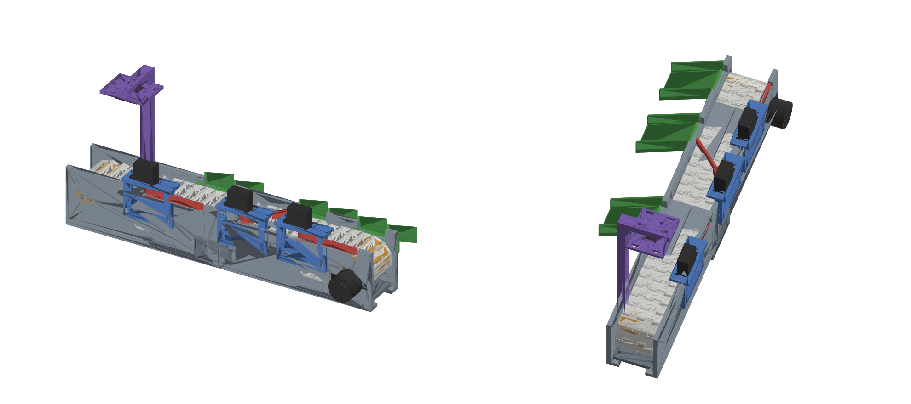
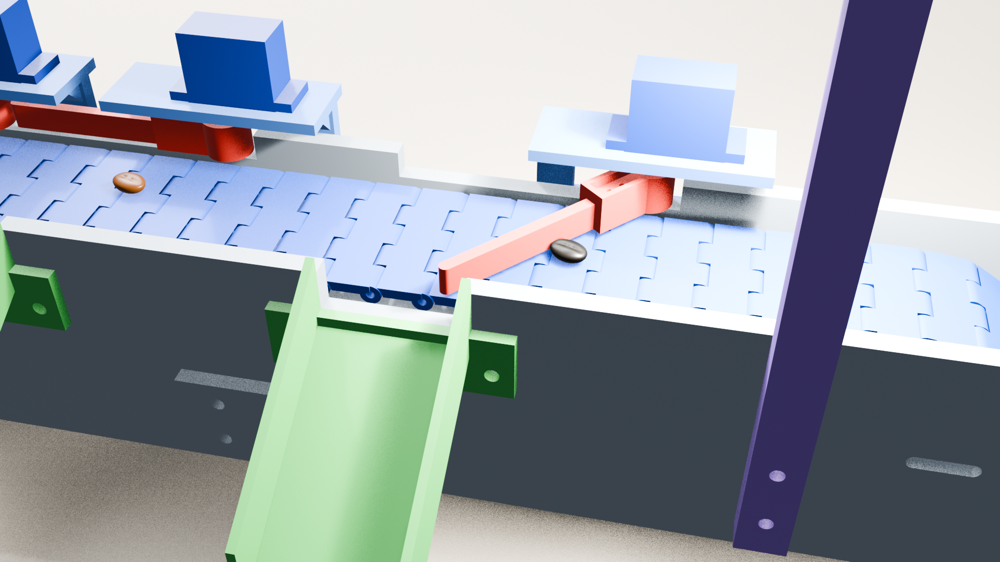

# Conveyor sorter: putting the Dry Bean classifier into a physical machine

This folder turns the classifier in this repository into a working sorting machine. It's a 3D-printable conveyor where a camera measures each bean, the model predicts its variety, and servo-driven gates divert it into the right bin.

```
camera frame ──► outline of each bean ──► 16 Dry Bean features ──► model (this repo's dataset)
                                                                       │ variety + confidence
Arduino ◄── "gate N, seen X ms ago" ◄── gate decision ◄────────────────┘
   │ counts belt motor steps
   └──► opens gate N when that bean arrives
```

| Document | What it covers |
|---|---|
| This README | Building, printing, wiring and running the machine |
| [DESIGN_NOTES.md](DESIGN_NOTES.md) | Each problem that had to be solved to connect the model to the hardware, the options, the decision and how it was checked |

**Status:** the model, the feature measurement and the machine design are checked in software. That covers the dataset formula check, simulated camera beans, interference checks of every part, and a Blender simulation of the gate timing. **The machine has not yet been built or run with real beans.**

**Quick start** (from this folder):

```bash
pip install opencv-python numpy pyserial scikit-learn
```

```bash
python vision/train_model.py
```

That trains on `../DryBeanDataset/Dry_Bean_Dataset.arff`. Then reproduce the checks in DESIGN_NOTES.md:

```bash
python vision/validate.py
```

---



## The machine

A 350 mm belt conveyor that you print and bolt together. It has:

- a **hinged-link belt** (PLA links, pinned with 1.75 mm filament) on **10-pocket polygon drums**. The belt sits in the pockets, so it can't slip on the drive drum.
- **28BYJ-48** stepper driving the discharge-end drum directly. The motor shaft goes into a double-D bore in the drum.
- a **camera mast** at x = 60 mm that holds the camera about 92 mm above the belt.
- **3 sorting gates** driven by **SG90** servos at x = 96 / 204 / 272 mm. Each gate is a paddle that lies flush in the wall until it's needed. Then it swings 48° across the belt, and the moving belt pushes the bean along it, through an opening in the far wall and down a chute. Beans that don't go to any gate ride off the end of the belt.

Every part fits the A1 mini's 180 × 180 × 180 mm bed and prints without supports.

```
 load ──►  [camera]   gate 1      gate 2         gate 3          ──► end of belt
 x=30       x=60      x=96        x=204          x=272              x=350
                      defects     other variety  unsure / unknown   target variety ("pack")
            ▲                 chutes are on the far side (wall B)
            mast    servos + paddles are on wall A, next to the motor
```

## Folders

| Path | What |
|---|---|
| `stl/` | Print-ready STLs, already oriented for printing. `_xN` in the name is how many to print |
| `cad/conveyor.py` | Parametric source. Change a number, re-run it, and you get new STLs |
| `firmware/bean_sorter/` | Arduino sketch: belt stepping, gate timing, serial commands |
| `vision/` | PC side: camera → measure the bean's 16 Dry Bean features → variety model → tell the Arduino which gate. `validate.py` reproduces the accuracy checks |
| `blender/` | Assembled model and a ready-made animation scene for Blender |

## Printing (PLA, 0.4 nozzle, 0.2 mm layers, no supports)

| STL | Qty | Notes |
|---|---|---|
| wall_load_A / wall_load_B / wall_drive_A / wall_drive_B | 1 each | 175 mm long, so turn the skirt/brim off. 3 walls, 25% infill. Printed lying on the outside face |
| drum_drive, drum_idler | 1 each | 4 walls, 30% infill. Hub faces up |
| drum_spacer | 3 | |
| belt_links_plate_32pcs_print | 2 | 64 links (60 + 4 spare). **Print in blue or green PLA**, because the vision code finds beans as "anything that isn't belt-coloured". The smooth bed side is the top of the belt |
| gate_fence, servo_bracket, chute | 3 each | |
| tie_bar ×4, tie_bar_joint ×1, splice_plate ×2 | | |
| camera_mast, camera_plate | 1 each | Mast prints lying flat |

## Hardware

| Item | Qty |
|---|---|
| 28BYJ-48 5 V stepper + ULN2003 driver board | 1 |
| SG90 servo (horns and screws come with it) | 3 |
| Arduino Uno or Nano | 1 |
| 5 V 2 A supply for the servos and motor | 1 |
| USB webcam, or Pi Camera / ESP32-CAM | 1 |
| M3 × 8 screws (tie bars) | 12 |
| M3 × 12 screws (splice plates, gate brackets, chutes, camera plate) | 22 |
| M3 × 16 screws (drum axles, mast) | 5 |
| M3 nuts | ~41 |
| M4 × 10 screws + M4 nuts (motor). M3 + washers also work | 2 |
| 1.75 mm filament, cut into 41 mm pins | 60 |
| White LED strip under the camera arm (recommended for even lighting) | 1 |

Almost every nut sits in a hex pocket on the inside face of a wall, so nothing sticks out where the belt runs.

## Assembly

1. **Frame:** Put the four walls on the table, inner faces up. Push M3 nuts into the hex pockets. Join each load half to its drive half with a **splice plate** on the outside (4 × M3×12). Stand the walls up facing each other and bolt the **tie bars** across the bottom flanges (M3×8 from the top into the nut pockets underneath). Use the wide tie bar at the joint. The two bed ledges should meet in the middle with about a 0.4 mm gap.
2. **Belt:** Snap the links together and push a 41 mm filament pin through each hinge. Briefly touch both ends of each pin with a soldering iron or lighter so they mushroom and can't walk out. If a hole is tight, run a 2 mm drill through it. Join 59 links into a strip for now.
3. **Drive drum:** Fit the 28BYJ-48 on the outside of wall A at the discharge end, with the shaft through the large hole (2 × M4). Push the drum's D-bore onto the shaft from inside. On wall B, put an M3×16 through the wall, add a spacer, and go into the drum's small bore.
4. **Idler drum:** In the slots at the load end, use M3×16 + spacer on each side. Leave them loose.
5. Wrap the belt over both drums. The knuckles must sit in the drum pockets, with the smooth side up. Add the 60th link. Slide the idler outward until the return run sags about 5 mm, then tighten the two slot screws.
6. **Gates:** Screw each SG90 into a **servo bracket**, shaft down. Bolt the bracket to wall A (2 × M3×12; the slots let you adjust the height). Run the servo to its park angle (90°). Press the single-arm horn into the paddle pocket, pointing along the paddle, and fix it with the horn screw from below plus a drop of CA glue. With the paddle lying flat in the wall notch, push the horn onto the servo spline. The paddle should clear the belt by about 1.5 mm.
7. **Chutes:** Bolt one below each opening in wall B (2 × M3×12). Put a cup under each.
8. **Camera:** Bolt the mast to wall B at x = 60 and screw the camera plate under the arm. It has a Pi-camera hole pattern and zip-tie slots for a webcam. Mount the LED strip beside the camera, aimed at the belt.

## Wiring

```
ULN2003 IN1..IN4  -> D8, D9, D10, D11      ULN2003 + / -  -> 5 V supply
SG90 #1 / #2 / #3 signal -> D3, D5, D6     SG90 red/brown -> 5 V supply (NOT the Arduino 5 V pin)
5 V supply GND  <->  Arduino GND (common ground is required)
Arduino USB -> PC
```

## Software

Firmware: open `firmware/bean_sorter/bean_sorter.ino` in the Arduino IDE (it only needs the built-in Servo library) and upload it.
Then, in the Serial Monitor at 115200 baud:

- `T 1`, `T 2`, `T 3` swings each gate. If a paddle swings outward instead of across the belt, swap its `OPEN_DEG` to `90 - 48 = 42`.
- `R 10` sets the belt to 10 rpm, which is 20 mm/s. 15 rpm is about the 28BYJ-48's limit.
- If the belt runs backwards, set `DIRECTION = -1`.

### PC: camera and bean classification

Beans are classified with this repository's dry-bean variety model. It takes the 16 shape features of the UCI Dry Bean dataset and predicts one of 7 varieties: Barbunya, Bombay, Cali, Dermason, Horoz, Seker or Sira. The conveyor measures those same 16 features from each bean's outline in the camera image (`vision/bean_features.py`).

What happens to each bean:

| Result | Gate |
|---|---|
| Your **target variety** (`target_varieties`, default `DERMASON`) | none: rides off the end into the "pack" bin |
| **Defect** caught by a colour rule (black or spotted) | 1 |
| **Another variety** | 2 (`other_variety_gate`) |
| **Unsure** (confidence below `min_confidence`) or **not a bean at all** (stone, chaff, broken piece) | 3 (`uncertain_gate`) |

To send particular varieties to particular gates, use `variety_gates`, for example `{"SIRA": 1}`.

**1. Install the packages:**

```bash
pip install opencv-python numpy pyserial scikit-learn
```

**2. Train the model** (once, about a minute):

```bash
python vision/train_model.py
```

This uses the dataset in `../DryBeanDataset/` and trains a gradient-boosting model, the same family as the LightGBM model PyCaret picked in the notebook. It saves the result to `vision/models/drybean_model.joblib`. It reports **92.5%** test accuracy with all 16 features; the notebook reported about 92–93%. `--model lgbm` uses LightGBM itself.

**3. Set up the camera view:**

```bash
python vision/sorter.py --dry-run
```

Use the dry run to set up `vision/config.json`:

- `roi` is a box around the belt in the image.
- `trigger_line_x` is the image column that sits exactly under the camera (x = 60 mm on the conveyor). Place a bean there and read its pixel position.
- `belt_moves_right_in_image`: set it to match how the camera is mounted.

Use at least 1280 × 720. The model relies on fine shape details, so more pixels per bean helps.

**4. Learn the belt colour.** Run this with the belt empty and moving:

```bash
python vision/sorter.py --calibrate
```

**5. Calibrate the scale.** Run about 30 beans of **one** known variety through:

```bash
python vision/sorter.py --dry-run --calibrate-scale DERMASON
```

The dataset's size features (area, lengths) are in the original camera's pixels. This step works out how many of those pixels one of your camera's pixels equals. Until you do it, the sorter uses a backup model that ignores size, which is only **78%** accurate; Bombay beans in particular are recognised mainly by their size. Redo this step if you move the camera or change the resolution.

**6. Run it for real:**

```bash
python vision/sorter.py --port COM5
```

The window labels each bean with its variety and confidence.

**Before relying on it:**
- **The colour rules come first.** Barbunya beans are naturally speckled, and Bombay beans are dark maroon. If you sort those varieties, tune or remove the `black` / `spotted` rules in `config.json` so they don't get rejected as defects.
- **Expect accuracy below 92.5% at first.** That number is on the dataset's own images, taken with a high-resolution camera. Your camera, lighting and outline detection differ. In simulated tests (`vision/validate.py`), the conveyor's measurements gave the same variety as the exact bean shape 95% of the time.
- **Retraining on your own beans fixes most of that.** Run each variety through and log its features, then retrain with those beans added:

```bash
python vision/sorter.py --dry-run --log my_beans.csv --label SIRA
```

```bash
python vision/train_model.py --extra my_beans.csv
```

**How the timing works:** The PC only reports "bean of type N crossed the line X ms ago". The Arduino counts motor steps, so it always knows where the belt is. It opens the gate when the bean is 22 mm before the pivot and keeps it open until the belt has moved 80 mm past it. A bean sliding along the paddle moves more slowly than the belt, so it needs that extra time. PC lag doesn't affect accuracy. Keep beans **at least ~105 mm apart**; otherwise an open gate can also catch the next bean. At 20 mm/s that's about one bean every 5 s. Speed up the belt or add a singulating feeder for more throughput.

## Blender animation



**Quickest way:** open `blender/conveyor_animated.blend` in Blender 4.2 or newer and press **Space** to play.

The scene is 1340 frames (about 45 s at 30 fps). Ten beans drop onto the belt, pass under the camera, and get sorted. Black and spotted beans go to gate 1, pale beans to gate 2, and the foreign piece to gate 3. The good beans ride off the end into the end bin.

**What's in the file**
- **Every printed part is its own named object.** Examples: `Wall_load_A`, `Belt_Link_00` to `Belt_Link_59`, `Drum_Drive`, `Gate_Paddle_1`, `Servo_Bracket_1`, `Chute_1`.
- **The parts are grouped** under `Frame`, `Belt`, `Gates`, `Camera_Mount` and `Electronics`, all parented to one `Conveyor` empty.
- **The moving parts have their origin on their pivot:** drums on the axle (they turn about Y), paddles on the servo shaft (Z), links on their hinge. That makes them easy to re-animate by hand.
- **The belt loops seamlessly.** Each link moves forward one link-length and then repeats (a Cycles modifier on its F-curves), so the belt runs for any frame range.
- **The bought parts are simple stand-ins:** the 28BYJ-48, the SG90s and the camera module.
- **Two cameras:** `Render_Camera` (overview, the active one) and `Closeup_Camera` (on the gates). To look through the close-up, select it and press Ctrl+Numpad 0.
- **Real-scale units** (metres). The scene is lit for EEVEE.

**To change it** (speed, bean order, colours, timing): edit the `SETTINGS` block at the top of `blender/animate_conveyor.py`. Then rebuild the scene in one of two ways:
- In Blender, open the script in the **Scripting** tab and run it.
- From a terminal:

```bash
blender -b --python blender/animate_conveyor.py -- --save blender/conveyor_animated.blend
```

**Other ways to use it**
- **Just the model:** `blender/conveyor_assembly.glb` works on its own (File → Import → glTF), and in other 3D software too.
- **After changing the CAD:** run `python cad/conveyor.py --blender` to regenerate the GLB, then re-run the animation script.

## Changing the design

All the dimensions are at the top of `cad/conveyor.py`: belt width, pitch, gate positions, wall height, and so on. Then run:

```bash
pip install manifold3d trimesh matplotlib
```

```bash
python cad/conveyor.py --check --preview
```

`--check` places every part in its assembled position, belt included, with each gate both parked and deployed, and reports any parts that overlap. Right now it reports none.

If you move a gate, change `GATE_X` in the firmware too.

## Things to check on your parts

- **28BYJ-48 shaft:** the D-bore is 5.2 mm with flats 3.16 mm apart and 9.5 mm deep. Clones vary. If it's loose, add a drop of CA glue. If it's tight, ream it.
- **SG90 horn:** the pocket fits a single-arm horn up to 17 mm long and 5 mm wide. Trim a longer horn.
- **Bean size:** the paddle is 7 mm tall, and there's 1.15 mm between the paddle tip and the far wall. That suits coffee, cocoa and soy beans. For large beans like kidney beans, raise `FENCE_H` and `W_H`.
